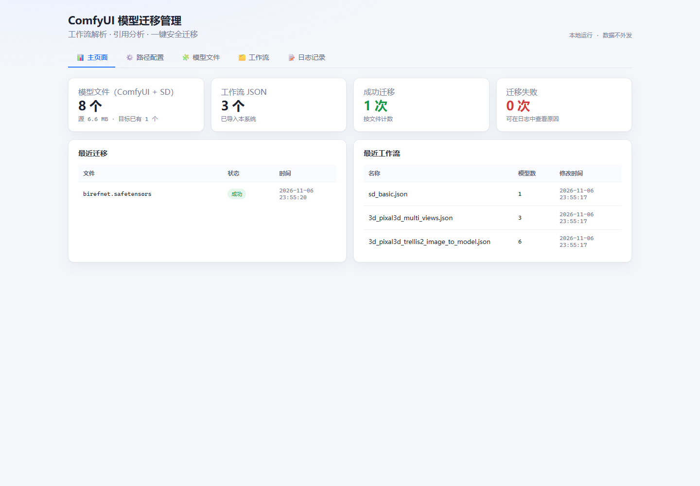

# ComfyUI 模型迁移管理

解析 ComfyUI 工作流引用的模型，识别跨工作流共享，确认后把模型**原子复制**到另一个 ComfyUI 目录。源文件永远保留，全过程有日志可查。

本地单用户工具：FastAPI + SQLite + Astro 静态前端，一个进程、一条命令启动。



## 功能

| Tab | 能做什么 |
|---|---|
| **主页面** | 源模型数 / 工作流数 / 迁移成功失败数 / 存储占用；最近迁移与最近工作流 |
| **路径配置** | 5 个路径 + 允许删除开关；保存前结构化校验；拖拽上传导入；扫描预览列出全部 JSON，支持全选/反选 |
| **模型文件（*.safetensors / *.gguf）** | 3 个模型目录；按 📂 目录分组，默认折叠，点击目录行展开/收起，支持一键展开/折叠；大小/引用数；大小排序；勾选批量迁移；空间预检；实时进度与取消 |
| **工作流** | 搜索工作流/模型/目录；默认折叠，点击行展开模型树，支持一键展开/折叠；显示 JSON 修改时间；打开目录、删除（可勾选同时删除本地 JSON）；目标端已有文件也可发起迁移 |
| **日志记录** | 按状态筛选、单条删除、按筛选清空 |

更多界面：[路径配置](docs/screenshots/paths.png) · [扫描预览](docs/screenshots/paths-scan.png) · [模型文件树](docs/screenshots/models.png) · [模型迁移弹窗](docs/screenshots/models-migrate.png) · [覆盖风险确认](docs/screenshots/overwrite.png) · [迁移进度](docs/screenshots/progress.png) · [工作流树](docs/screenshots/workflows.png) · [共享模型确认](docs/screenshots/migrate-modal.png) · [迁移结果](docs/screenshots/migrate-result.png) · [日志](docs/screenshots/logs.png)

## V1.0 Windows 便携版

发布包：[ComfyUI-Model-Migrator-v1.0.0-Windows-x64.zip](release/ComfyUI-Model-Migrator-v1.0.0-Windows-x64.zip)

- Windows 10/11 64 位，内置 Python 运行时，**无需安装 Python / Node.js / 数据库**。
- 解压后双击 `启动.cmd`（或 `Start-Portable.cmd`），浏览器自动打开。
- 数据保存在启动脚本同级 `data/` 目录，备份该目录即可。
- 使用说明：[USER-GUIDE.txt](packaging/USER-GUIDE.txt)
- 变更记录：[CHANGELOG.md](CHANGELOG.md)
- 校验和：[SHA256SUMS.txt](release/SHA256SUMS.txt)

重新构建：

```powershell
cd web; pnpm build; cd ..
.\packaging\prepare-runtime.ps1
.\packaging\build-portable.ps1 -Version 1.0.0
```

> 便携版使用 Python 官方签名的嵌入式运行时，不会遇到未签名 exe 被 Smart App Control 直接拦截的问题。

设计细节：

- 工作流既支持 ComfyUI **UI 图格式**（`nodes` / `widgets_values`），也支持 **API 格式**（`{ "3": { "inputs": ... } }`）。
- 引用解析成统一身份 `models/<目录>/<文件名>`。ComfyUI 工作流通常只存文件名，因此导入时会扫描已配置的模型目录补全目录。
- 迁移源按「ComfyUI 根 → SD 根」顺序解析；同名模型以 ComfyUI 为准。目标里已有的文件会标为「已迁移」或「已在目标」，不会再被当作缺失。
- 迁移目标根目录可以填 ComfyUI 根（文件落到其 `models/`）或 `models/` 目录本身。
- 迁移用「目标目录写临时文件 + `os.replace`」保证原子性；目标已有同大小、同修改时间的文件时直接跳过。
- 模型页的「迁移」弹窗会列出三个位置供勾选；默认只复制，勾选「剪贴」并二次确认后才删除源文件。共享工作流数量会显示在弹窗里。
- 每个模型前有勾选框，表头支持全选当前筛选结果；「批量迁移」一次提交多个文件，共用同一个目标位置和复制/剪贴选项。
- 迁移只写入三个已配置根目录之一；路径穿越（`..`、盘符、绝对路径）仍会被拒绝。
- 所有路径在存储、日志、界面和 API 中统一使用正斜杠（`G:/ComfyUI-Shared/models`），UNC 前缀保留为 `//server/share`。
- 保存路径前调用校验：必填根目录必须存在、可读；目标必须可写，且不能与源目录相同或位于源目录内部。可选 SD 目录缺失只提示、不阻止保存。
- 迁移前先做空间预检：按源文件大小汇总、对比目标盘剩余空间，不足直接拒绝；后端执行前还会再检查一次。
- 默认复制；只有设置页开启「允许删除源文件」后，弹窗才显示剪贴入口，且剪贴要二次确认。
- 迁移通过后台任务执行：复制循环按 4 MB 分块更新字节/百分比/速度/ETA；取消会停止循环并清理 `.part` 临时文件，已完成文件保留。
- 目标与源为同一位置时，剪贴会被告警并禁用确认，避免“开始剪贴但什么也没发生”。
- 目标端已有同名文件时，弹窗显示「覆盖」勾选项，并做首尾 1 MB 快速指纹比对；大小不同或内容特征不同会列出风险，未勾选覆盖时禁止执行。

## 快速开始

要求：Python 3.11+、Node.js 18+、pnpm。

```powershell
cd D:\working\comfyui-build

python -m venv .venv
.\.venv\Scripts\python.exe -m pip install -r requirements.txt

cd web
pnpm install
pnpm build
cd ..

.\.venv\Scripts\python.exe -m uvicorn main:app --host 127.0.0.1 --port 8765
```

打开 <http://127.0.0.1:8765>。也可以直接运行：

```powershell
.\start.cmd            # 首次会自动装依赖、构建前端（推荐，兼容脚本执行策略）
.\start.cmd -Port 9000
```

若 PowerShell 已允许运行本地脚本，也可以 `.\start.ps1`。

前端热更新：后端保持运行，另开一个终端执行 `cd web; pnpm dev`，访问 <http://127.0.0.1:4321>（`/api` 已代理到 8765）。

所有运行数据在 `data/`：`app.db`（SQLite）、`config.json`、`uploads/`。停止服务后删除 `data/` 即可重置。

> 当前本机配置指向 `G:/ComfyUI-Shared/models`、`I:/models` 等真实目录（见 `data/config.json`）。换机器或换目录时在「路径配置」或「模型文件」页修改并保存。
>
> `scripts/seed_demo.py` 仅用于体验演示数据：它会**覆盖配置**并导入 3 个演示工作流，接入真实目录后不要运行。

## 使用流程

1. **路径配置**：填写 ComfyUI 模型根目录（`G:/ComfyUI-Shared/models` 或它的上级 ComfyUI 目录均可）、SD 模型根目录（可选）、迁移目标根目录（同样可填 ComfyUI 根或 `models/`）、工作流目录。
2. **导入**：点「扫描工作流目录…」勾选导入，或拖拽上传 JSON。
3. **模型文件**：按目录分组查看；勾选文件名前的复选框（表头可全选当前筛选结果），点「批量迁移」；单行也可直接点「迁移」。默认复制，可选剪贴。
4. **工作流**：点任意行展开模型树；`已迁移` / `已在目标` / `未迁移` / `未找到` 会区分显示；点「迁移」或「重新迁移」。
5. **核对**：迁移完成自动记录日志；源文件仍在原处。工作流的「删除」只删记录，不删磁盘 JSON。

> 建议先配置模型路径、再导入工作流。若顺序反了（或后来才补上模型文件），删除对应工作流后重新扫描，即可按当前磁盘重新解析；工作流文件本身不受影响。

## 架构

```
web/ (Astro 静态构建，5 个 Tab)
   │  fetch /api/*
   ▼
routers/  (config · stats · models · workflows · upload · analyze · migrate · logs)
   │
   ├─ services/parser.py     工作流 JSON → 模型引用
   ├─ services/catalog.py    模型根目录 → 索引 → 引用解析（按路径/文件名/目标）
   ├─ services/importer.py   工作流 / 模型 / 关联的单事务写入
   ├─ services/inventory.py  源 + 目标的模型清单与迁移状态
   ├─ services/tree.py       相对路径 → 目录树
   ├─ services/mover.py      路径边界校验 + 原子复制
   ├─ services/paths.py      正斜杠路径规范化
   └─ services/analysis.py   共享模型与候选迁移项
   │
   ▼
SQLite (data/app.db) + JSON 配置 (data/config.json)
```

核心模块都很薄地暴露一个接口：

| 模块 | 接口 |
|---|---|
| `parser` | `extract_model_refs(document) -> list[str]` |
| `catalog` | `ModelCatalog(roots).resolve(ref) -> ResolvedModel` |
| `importer` | `register_workflow(conn, catalog, name, path, refs, target) -> id` |
| `inventory` | `build_inventory(comfy, sd, target) -> {summary, models}` |
| `mover` | `target_path(root, rel_path)` / `copy_atomic(src, dst)` |

表结构：`workflows`、`models`、`workflow_models`、`migrations`。`workflows.file_path` 唯一，重复导入会替换关联；`models.rel_path` 唯一，跨工作流共享才有意义。

## API

| 方法 | 路径 | 说明 |
|---|---|---|
| GET / POST | `/api/config` | 读取 / 保存 5 个路径与删源开关 |
| POST | `/api/config/validate` | 结构化校验路径（errors / warnings） |
| GET | `/api/stats` | 主页面统计（含目标模型数） |
| GET | `/api/models` | 源 + 目标模型清单、汇总、根目录存在状态 |
| GET | `/api/workflows` | 工作流 + 模型 + 目录树（含目标状态） |
| DELETE | `/api/workflows/{id}?delete_file=true` | 删除记录；`delete_file=true` 时同时删除本地 JSON |
| POST | `/api/workflows/{id}/open` | 在资源管理器中打开 JSON 所在目录 |
| GET | `/api/workflows/scan/preview` | 扫描目录并列出文件与已导入状态 |
| POST | `/api/workflows/scan/import` | 只导入勾选的工作流路径 |
| POST | `/api/workflows/import-path` | 按绝对路径导入单个工作流 |
| POST | `/api/workflows/scan` | 扫描两个工作流目录并全量入库 |
| POST | `/api/upload` | multipart 上传 `.json`，保存并解析 |
| GET | `/api/analyze?model_id=&workflow_id=` | 共享工作流 + 候选模型 + 目标端状态 |
| POST | `/api/migrate/preflight` | 空间预检（需要/可用字节、逐文件动作） |
| POST | `/api/migrate/tasks` | 创建后台迁移任务，返回 `task_id`；可带 `overwrite: true` |
| GET | `/api/migrate/tasks/{id}` | 任务状态、字节进度、速度、ETA、逐文件结果 |
| POST | `/api/migrate/tasks/{id}/cancel` | 取消任务（清理未完成临时文件） |
| POST | `/api/migrate` | 同步迁移接口，保留给脚本/测试；支持 `overwrite` |
| GET | `/api/logs` | 查询（`status`、`limit`） |
| DELETE | `/api/logs/{id}` | 删除单条 |
| DELETE | `/api/logs?status=` | 清空（可按状态） |
| GET | `/api/health` | 健康检查与数据目录 |

交互式文档：<http://127.0.0.1:8765/docs>。

## 测试

```powershell
.\.venv\Scripts\python.exe -m pytest -q
```

64 个测试，覆盖：路径规范化、配置校验与持久化、空间预检、引用提取（含 subgraph）、引用解析、路径安全与原子复制、源 + 目标清单与工作流引用数、目录分组、目标位置勾选、同名冲突/覆盖、快速指纹、批量迁移、跨根复制、剪贴门控、异步任务进度/完成/取消、复制取消清理、绝对路径/扫描导入、工作流修改时间/打开目录/删除本地 JSON、入口页缓存、迁移跳过/覆盖、HTTP 全流程。

## 目录

```
main.py                 应用入口（含静态前端挂载）
settings.py             数据目录 / 前端产物路径
db.py                   SQLite 连接、schema 与路径归一化
config_store.py         config.json 原子读写
schemas.py              Pydantic 请求模型
routers/                8 个 HTTP 适配器
services/               解析、索引、清单、校验、预检、导入、树、迁移、分析
tests/                  pytest
web/                    Astro 前端（5 个 Tab）
scripts/seed_demo.py    演示数据（会覆盖配置，谨慎运行）
docs/ARCHITECTURE.md    架构分析与取舍
docs/USER-STORIES.md    用户故事适配评估与后续建议
docs/adr/               四个关键决策
GLOSSARY.md             领域术语
```

## 设计文档

- [架构分析：以深模块视角审查原设计](docs/ARCHITECTURE.md)
- [用户故事适配评估与后续建议](docs/USER-STORIES.md)
- [ADR 0001：用模型相对路径作为身份](docs/adr/0001-model-identity.md)
- [ADR 0002：迁移只复制、不移动](docs/adr/0002-copy-not-move.md)
- [ADR 0003：路径统一以正斜杠存储与展示](docs/adr/0003-forward-slash-paths.md)
- [ADR 0004：默认复制，显式剪贴才删除源文件](docs/adr/0004-optional-cut.md)
- [术语表](GLOSSARY.md)

## 已知取舍

- 单用户、本机运行，无鉴权；如需暴露到局域网，请自行加反向代理与认证。启动脚本只绑定 `127.0.0.1`。
- 迁移通过后台任务 + 300ms 轮询展示进度；未用 SSE，因为本地单用户场景轮询更简单可靠。同步 `/api/migrate` 仍保留给脚本/测试。
- 工作流列表显示 JSON 文件的磁盘修改时间；「打开」由本地服务调用资源管理器，因此只适合本机运行。
- 主页面最近迁移/最近工作流与日志页的文件名可单击复制；长名称省略显示，悬停可看完整内容。日志的源/目标列显示绝对路径，点击任意位置复制文件名。
- 异步任务在进程内存中，服务重启后进行中的任务会丢失（已完成文件与日志保留）。
- 哈希校验尚未实现：同名冲突用「大小 + 首尾 1 MB 快速指纹」判断，比只看大小可靠，但仍不是完整 SHA256；两者一致但中间内容不同（极少见）会被跳过。
- `/api/stats`、`/api/models` 每次请求实时扫描目录，换来「零索引维护」；模型数量特别大时可加缓存。
- 未做 SHA256 校验与工作流版本历史；重复导入只保留最新关联。
